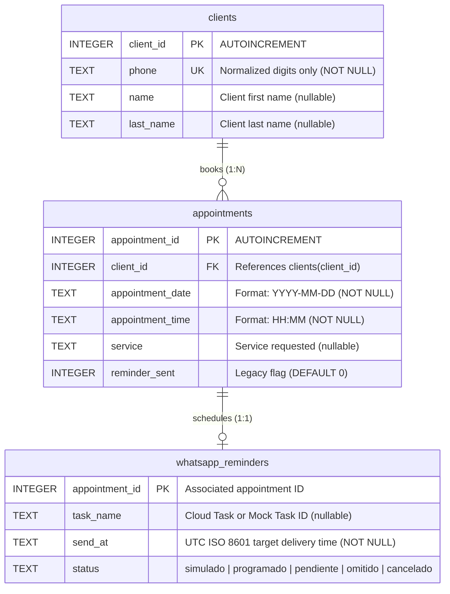
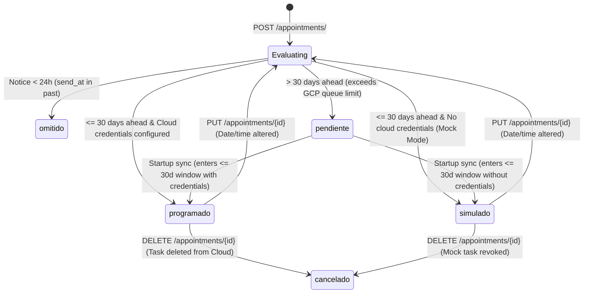

# Database Schema Reference

This document provides a comprehensive technical reference for the SQLite database schema of the **Barber Shop** application, located at `Database/peluqueria.db`.

---

## 1. Architecture Overview

The database is built on **SQLite 3**, managed via Python's standard `sqlite3` module through [`DatabaseManager`](backend/src/app/database_manager.py).

Key architectural properties:
- **Foreign Key Enforcement:** Enabled on every connection using `PRAGMA foreign_keys = ON;`.
- **Concurrency & Thread Safety:** Connected with `check_same_thread = False` to support FastAPI's asynchronous thread pool.
- **Dictionary Row Access:** Uses `sqlite3.Row` factory so queries return dictionary-accessible row representations (`row["column_name"]`).
- **Normalized Data Structure:** Contact information is isolated in `clients`, booking slots in `appointments`, and automated notification schedules in `whatsapp_reminders`.

---

## 2. Entity-Relationship Diagram



---

## 3. Table Specifications

### 3.1. `clients` Table

Stores client contact details and identity. To minimize friction for the barber during busy hours, only the phone number is strictly required.

| Column | Type | Constraints | Description |
|---|---|---|---|
| `client_id` | `INTEGER` | `PRIMARY KEY AUTOINCREMENT` | Internal synthetic identifier for the client. Immutable. |
| `phone` | `TEXT` | `NOT NULL UNIQUE` | Normalized Spanish phone number (9 digits, prefixes and symbols stripped, e.g. `666111222`). |
| `name` | `TEXT` | `NULL` | First name of the client. |
| `last_name` | `TEXT` | `NULL` | Last name / surname of the client. |

#### DDL Statement:
```sql
CREATE TABLE IF NOT EXISTS clients (
    client_id INTEGER PRIMARY KEY AUTOINCREMENT,
    phone TEXT NOT NULL UNIQUE,
    name TEXT,
    last_name TEXT
);
```

---

### 3.2. `appointments` Table

Stores scheduled bookings and links each appointment to an existing client record.

| Column | Type | Constraints | Description |
|---|---|---|---|
| `appointment_id` | `INTEGER` | `PRIMARY KEY AUTOINCREMENT` | Unique identifier generated for the appointment. |
| `client_id` | `INTEGER` | `NOT NULL`, `FOREIGN KEY` | Foreign key referencing `clients(client_id)`. `ON UPDATE CASCADE`, `ON DELETE RESTRICT`. |
| `appointment_date` | `TEXT` | `NOT NULL` | Local appointment date in ISO format: `YYYY-MM-DD`. |
| `appointment_time` | `TEXT` | `NOT NULL` | Local appointment time in 24h format: `HH:MM`. |
| `service` | `TEXT` | `NULL` | Hairdressing service description (e.g., `Corte degradado`, `Barba`). |
| `reminder_sent` | `INTEGER` | `DEFAULT 0` | Legacy integer flag kept for backward compatibility. |

#### DDL Statement:
```sql
CREATE TABLE IF NOT EXISTS appointments (
    appointment_id INTEGER PRIMARY KEY AUTOINCREMENT,
    client_id INTEGER NOT NULL,
    appointment_date TEXT NOT NULL,
    appointment_time TEXT NOT NULL,
    service TEXT,
    reminder_sent INTEGER DEFAULT 0,
    FOREIGN KEY (client_id) REFERENCES clients(client_id)
        ON UPDATE CASCADE
        ON DELETE RESTRICT
);
```

> **Referential Integrity Rule:** `ON DELETE RESTRICT` prevents accidental deletion of a client who has historical appointments, preserving business accounting records.

---

### 3.3. `whatsapp_reminders` Table (Automated Reminders)

Manages the lifecycle of automated WhatsApp messages scheduled to be sent **exactly 24 hours prior** to each appointment.

| Column | Type | Constraints | Description |
|---|---|---|---|
| `appointment_id` | `INTEGER` | `PRIMARY KEY` | Primary key identifying the reminder, corresponding to `appointments(appointment_id)`. |
| `task_name` | `TEXT` | `NULL` | Resource identifier from Google Cloud Tasks (e.g. `projects/.../locations/.../tasks/...`) or simulation identifier (`mock-task-<id>-<timestamp>`). `NULL` if omitted or pending. |
| `send_at` | `TEXT` | `NOT NULL` | Exact UTC ISO 8601 target dispatch time (`YYYY-MM-DDTHH:MM:SS+00:00`). Calculated by subtracting 24 hours from appointment local time in `Europe/Madrid`. |
| `status` | `TEXT` | `NOT NULL` | Current lifecycle state: `simulado`, `programado`, `pendiente`, `omitido`, `cancelado`. |

#### DDL Statement:
```sql
CREATE TABLE IF NOT EXISTS whatsapp_reminders (
    appointment_id INTEGER PRIMARY KEY,
    task_name TEXT,
    send_at TEXT NOT NULL,
    status TEXT NOT NULL
);
```

> **Design Rationale (Decoupled FK):** This table avoids a cascading delete trigger at database level so that if an appointment is removed (e.g., via the console menu or API), the reminder record remains trackable long enough for the server to successfully issue the deletion call to Google Cloud Tasks before finalizing the record state to `cancelado`.

---

## 4. Reminder Lifecycle & Status State Machine

The `status` column in `whatsapp_reminders` follows a deterministic lifecycle:



### Status Definitions:
1. **`simulado` (Simulation Mode):** The appointment is valid and scheduled within 30 days, but no Google Cloud/Meta credentials are configured in `.env`. The system logs `[WHATSAPP MOCK]` and creates a mock task ID. Zero cloud requests are made.
2. **`programado` (Scheduled in Cloud):** Google Cloud Tasks API successfully created an HTTP task configured to deliver the Meta template payload to WhatsApp at `send_at`.
3. **`pendiente` (Pending Window Entrance):** Google Cloud Tasks enforces a hard scheduling quota of 30 days into the future. Appointments created further in advance remain `pendiente` without a task name until the server startup synchronization catches them within the 30-day window.
4. **`omitido` (Omitted):** The booking was made less than 24 hours before the appointment time (the computed `send_at` is already in the past). Sending is skipped.
5. **`cancelado` (Cancelled):** The appointment was canceled or rescheduled. Any active task was deleted from Google Cloud Tasks to ensure no unwanted message reaches the client.
