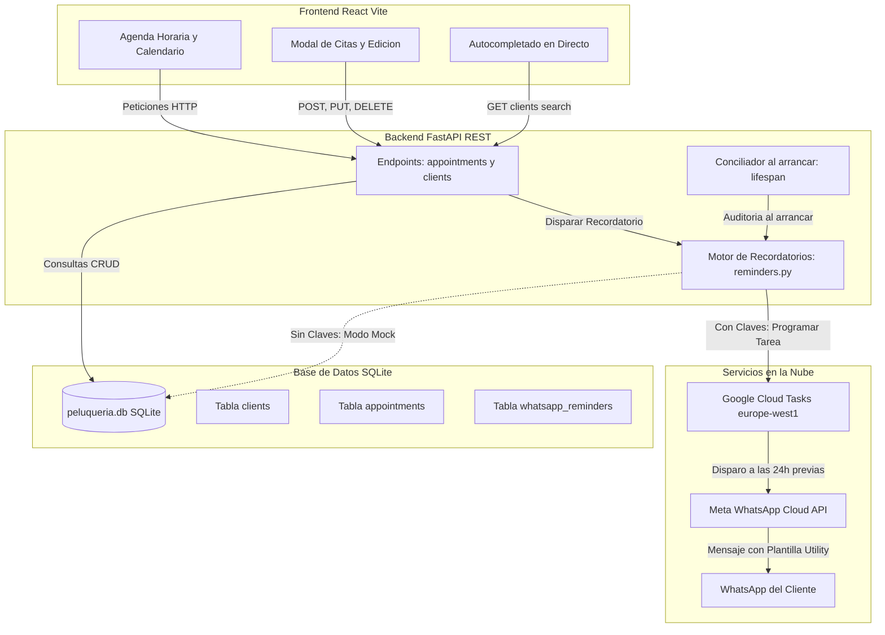

[🇪🇸 Versión en Español](README_es.md) | [🇬🇧 English Version](README.md)

# Barber Shop

> **Sistema Full-Stack de Gestión de Citas y Recordatorios Automatizados por WhatsApp**
> Desarrollado para una barbería real con el objetivo de eliminar las inasistencias de clientes (*no-shows*), agilizar la gestión de la agenda y sustituir los libros de papel por una aplicación web moderna, responsiva y tolerante a desconexiones.

[](https://www.python.org/)
[](https://fastapi.tiangolo.com/)
[](https://react.dev/)
[](https://vitejs.dev/)
[](https://www.sqlite.org/)
[](https://cloud.google.com/tasks)
[](https://developers.facebook.com/docs/whatsapp/cloud-api)
[]()
[](LICENSE)

---

## 1. Visión General y Problema de Negocio

Las barberías locales suelen gestionar sus turnos mediante cuadernos de papel o mensajes dispersos en WhatsApp, lo que provoca tres grandes problemas:
1. **Inasistencias y olvidos (*No-Shows*):** Los clientes olvidan su cita si no reciben un recordatorio previo, generando huecos improductivos y pérdidas de ingresos.
2. **Fricción al agendar:** Dificultad para consultar de un vistazo los huecos libres del día, revisar el historial de un cliente o autocompletar clientes habituales.
3. **Dependencia del PC encendido:** Los programadores tradicionales de escritorio solo envían mensajes si el ordenador de la peluquería permanece encendido por la noche.

**Barber Shop** resuelve estos problemas mediante una arquitectura desacoplada y eficiente:
- Una aplicación web en **React + Vite** con interfaz dividida: mini-calendario lateral y agenda horaria en tiempo real.
- Un backend REST en **FastAPI + SQLite** con validación estricta de esquemas Pydantic y control de integridad referencial.
- Un subsistema de automatización serverless con **Google Cloud Tasks** y la **Meta WhatsApp Cloud API**, que programa y entrega el mensaje exactamente **24 horas antes** de la cita incluso con el ordenador del negocio apagado.
- Un **Modo Simulación** integrado que permite ejecutar y probar la aplicación al 100% en local sin necesidad de claves de API ni costes en la nube.

---

## 2. Características Principales

- **Agenda Horaria y Calendario Dividido:** Visualización simultánea del calendario y las franjas horarias del día. Permite ver las citas pendientes de hoy, filtrar por fecha o consultar el historial de clientes.
- **Autocompletado de Clientes en Tiempo Real:** Búsqueda predictiva mientras se escribe por nombre o teléfono, mostrando al instante el número de visitas acumuladas y el último servicio realizado.
- **Recordatorios Automáticos 24h por WhatsApp:** Cálculo de envíos en la zona horaria `Europe/Madrid` con soporte para cambios de hora oficiales (DST). Si una cita se edita o cancela, la tarea programada en la nube se revoca al instante.
- **Modo Simulación Sin Claves (Mock Engine):** Si no se configuran credenciales en `.env`, el sistema opera automáticamente en modo simulado (`status = 'simulado'`), registrando tareas mock sin emitir errores de red.
- **Conciliación al Iniciar el Servidor (`lifespan`):** Al arrancar FastAPI, el servidor audita la base de datos: programa citas futuras pendientes que hayan entrado en la ventana de 30 días y cancela tareas huérfanas si una cita fue eliminada.
- **Registros de Decisiones de Arquitectura (ADRs):** Justificación técnica formal de cada elección de diseño (claves sintéticas vs naturales, concurrencia en SQLite, convención REST) en [`decisions.md`](decisions.md).

---

## 3. Arquitectura del Sistema



---

## 4. Stack Tecnológico

| Área | Tecnología | Justificación |
|---|---|---|
| **Frontend** | React 18, Vite, CSS puro | Tiempos de carga ultrarrápidos, componentes modulares sin librerías pesadas innecesarias. |
| **Backend** | Python 3.11+, FastAPI, Pydantic | API asíncrona de alto rendimiento, documentación OpenAPI automática (`/docs`) y tipado estricto. |
| **Base de Datos** | SQLite 3 (`check_same_thread=False`) | Base de datos embebida en un único archivo, cero mantenimiento e integridad por claves foráneas (`PRAGMA foreign_keys = ON;`). |
| **Programador Cloud** | Google Cloud Tasks | Cola de tareas serverless con soporte para llamadas HTTP programadas hasta 30 días en el futuro. Capa gratuita de 1.000.000 tareas/mes. |
| **Mensajería** | Meta WhatsApp Cloud API | Canal oficial de WhatsApp Business mediante plantillas de categoría *Utility*. |
| **Pruebas** | `unittest`, `FastAPI TestClient`, `zoneinfo` | Batería aislada de pruebas unitarias y 37 aserciones estrictas de casos límite (*edge cases*). |

---

## 5. Instalación y Puesta en Marcha

### Prerrequisitos
- Python 3.11 o superior
- Node.js 18 o superior y npm
- Git

### 1. Clonar el repositorio
```bash
git clone https://github.com/pabloneiras/barber-shop.git
cd barber-shop
```

### 2. Configurar el Backend
```bash
# Crear entorno virtual
python -m venv .venv

# Activar entorno virtual (PowerShell en Windows)
.\.venv\Scripts\Activate.ps1

# Instalar dependencias
pip install -r requirements.txt

# Iniciar servidor backend
python -m uvicorn --app-dir backend/src api.api:app --reload --port 8000
```
La API estará lista en `http://localhost:8000` y la documentación interactiva en `http://localhost:8000/docs`.

### 3. Configuración del Entorno y Claves API (`.env`)
La aplicación busca las variables de configuración en un archivo `.env` en la **raíz del proyecto**. Se incluye una plantilla lista en [`.env.example`](.env.example):

```bash
# Copiar plantilla a .env en Windows PowerShell:
Copy-Item .env.example .env

# O en Linux / macOS / Bash:
cp .env.example .env
```

#### Modos de Ejecución:
- **Modo Simulación Local (Por defecto — Sin claves):**
  Si dejas `.env` vacío o no configuras claves en la nube, el sistema funciona al **100% en local sin coste**. Los recordatorios se calculan con zona horaria de Madrid, se validan y se registran como tareas simuladas (`status = 'simulado'`).
- **Modo Producción (Envíos reales por WhatsApp):**
  Para activar los envíos reales mediante Meta y Google Cloud Tasks, rellena tus credenciales dentro de `.env`:
  ```env
  # Meta WhatsApp Cloud API
  META_ACCESS_TOKEN=tu_token_permanente_de_system_user
  META_PHONE_NUMBER_ID=tu_phone_number_id_de_whatsapp
  META_API_VERSION=v21.0
  META_TEMPLATE_NAME=recordatorio_cita
  META_TEMPLATE_LANG=es

  # Google Cloud Tasks (Programador Externo)
  GCP_PROJECT=tu_id_de_proyecto_gcp
  GCP_LOCATION=europe-west1
  GCP_QUEUE=recordatorios-whatsapp
  GOOGLE_APPLICATION_CREDENTIALS=C:\ruta\a\tu\service-account-key.json
  ```
  > Para ver el tutorial paso a paso sobre cómo obtener los tokens en Meta for Developers y configurar la cola en Google Cloud, consulta la [**Guía de Configuración de Credenciales (`WHATSAPP_SETUP.md`)**](WHATSAPP_SETUP.md).

### 4. Configurar el Frontend (Desarrollo)
En una terminal separada:
```bash
cd frontend
npm install
npm run dev
```
Abre `http://localhost:5173` en tu navegador.

### 5. Ejecución Unificada en Producción (1 Solo Proceso)
Alternativamente, puedes compilar el frontend una vez y ejecutar tanto la API como la interfaz web de React desde el mismo servidor FastAPI en el puerto 8000:
```bash
# Compilar el frontend en la carpeta frontend/dist
cd frontend && npm run build && cd ..

# Iniciar servidor unificado (o doble clic en run_app.bat en Windows)
.\run_app.bat
```
Entra a `http://localhost:8000` en tu navegador para usar la aplicación.

---

## 6. Pruebas y Control de Calidad

El proyecto incluye dos suites de pruebas automatizadas sobre bases de datos SQLite aisladas y temporales:

```bash
# 1. Pruebas de integración principales (15 tests)
.\.venv\Scripts\python.exe tests/run_tests.py

# 2. Suite exhaustiva de casos límite (37 tests)
$env:PYTHONPATH="backend/src"; .\.venv\Scripts\python.exe tests/test_edge_cases.py
```

### Casos Límite Verificados (37/37 Superados):
- **Cambios de hora oficiales (DST):** Transiciones de primavera (marzo) y otoño (octubre) en `Europe/Madrid`.
- **Sanitización de teléfonos:** Manejo robusto de `+34`, `0034`, espacios intermedios, guiones y números ya prefijados con `34`.
- **Fallback en nombres de cliente:** Asignación segura de `"Cliente"` ante nombres vacíos, nulos o de solo espacios. Soporte de caracteres acentuados Unicode.
- **Frontera de 24 horas:** Omisión automática (`status = 'omitido'`) para reservas hechas con menos de 24h de margen.
- **Límite de 30 días de GCP:** Marcado como pendiente (`status = 'pendiente'`) para citas a más de 30 días vista, programándolas cuando entren en ventana.
- **Edición y cancelación:** Revocación inmediata de tareas programadas al modificar fecha/hora o eliminar citas.
- **Conciliación de arranque:** Detección y cancelación de tareas huérfanas procedentes de citas eliminadas fuera de la API.

---

## 7. Índice de Documentación

- **[`DATABASE_SCHEMA.md`](DATABASE_SCHEMA.md):** Esquema completo de la base de datos, diagrama entidad-relación y máquina de estados de recordatorios.
- **[`WHATSAPP_SETUP.md`](WHATSAPP_SETUP.md):** Guía paso a paso para configurar las credenciales de Meta Cloud API y Google Cloud Tasks.
- **[`decisions.md`](decisions.md):** Registros de Decisiones de Arquitectura (*ADRs*) que documentan las decisiones técnicas tomadas.
- **[`.env.example`](.env.example):** Plantilla para las variables de entorno de producción.

---

## 8. Licencia

Distribuido bajo la Licencia MIT. Consulta [`LICENSE`](LICENSE) para más información.
